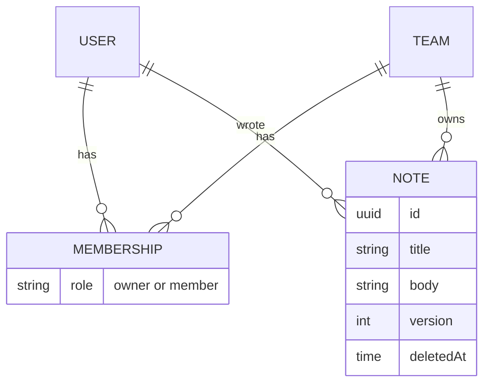
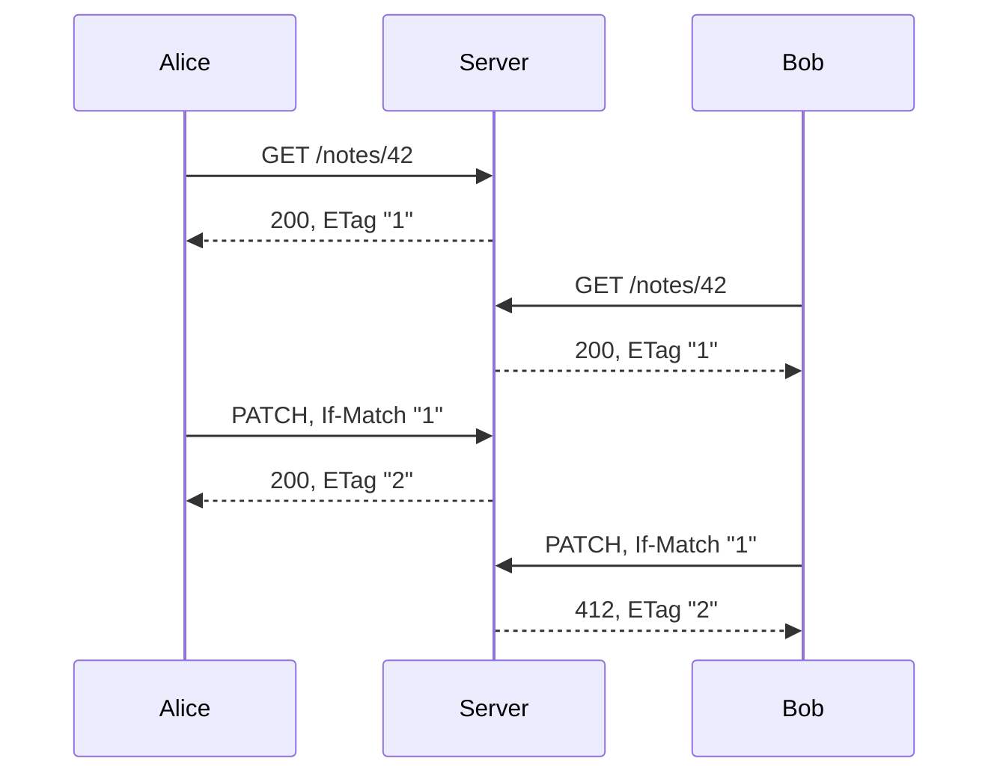

# How the service works

Team Notes is a REST API for notes shared within small teams. The contract is [`spec/openapi.yaml`](../spec/openapi.yaml), with a rendered reference at [`docs/api.html`](api.html). The rules it must follow are in [`spec/acceptance-criteria.md`](../spec/acceptance-criteria.md).

## Data model

- **Notes:** a note belongs to one team. Every member of that team can read and edit it, and its author is kept.
- **Versions:** every change increments `version` by one.
- **Storage:** all nine backends share one SQLite schema, [`spec/schema.sql`](../spec/schema.sql).

## Visibility

If you can't see something, you get a 404, and the 404 body is byte-for-byte the same in every one of these cases:
- a note in a team you aren't in
- an id that never existed
- a malformed id
- a deleted note
- an unknown route

Probing ids tells an outsider nothing.

| Request | Response |
|---|---|
| Anything except `/health`, without a valid token | 401 |
| Another team's note, a random id, `/notes/%E0`, `/notes/{id}/` | 404, identical bytes |
| A team member who is not the owner changes membership | 403, because they can already see the team |

## Concurrent edits

Every single-note response carries `ETag: "<version>"`. To update a note, send that value back in `If-Match`:
- **Atomic:** the server checks and increments in one statement, `UPDATE … WHERE id = ? AND version = ?`.
- **Stale copy:** if someone else changed the note first, you get **412** along with the current ETag.
- **No precondition:** with no `If-Match`, or `If-Match: *`, you get **428**. There are no blind overwrites.

The suite checks this sequentially, and also fires 16 simultaneous PATCHes at one note and requires exactly one to succeed.

## Delete and restore

- **Delete:** `DELETE` sets `deletedAt` and keeps the content. Repeating it returns 204 again, and it does not change `version`.
- **Restore:** `POST /notes/{id}/restore` brings the note back and increments `version`, so anyone still holding a version from before the delete gets 412.
- **Trash:** `GET /teams/{id}/notes?archived=true` lists a team's deleted notes.

## Teams

- **Creating:** anyone can create a team (`POST /teams` with a slug id) and becomes its owner.
- **Membership:** only the owner adds or removes members. Access changes on the next request: a removed member gets 404, even for notes they wrote.
- **Notes stay:** those notes remain with the team.
- **Last owner:** the last owner can't be removed (409).

## Errors

Every error is an RFC 9457 `application/problem+json` document. When a request has several problems, the first one in this order is reported, in every backend:

**401 → 404 → 403 → 415 → 413 → 400 → 422 → 409 → 428 → 412**

That's authentication, then visibility, then permission, then the body (media type, size, JSON syntax, field validation), then state (conflict, then the version precondition). A caller who isn't allowed learns nothing about their request body.

Request bodies must be valid JSON with valid Unicode (I-JSON, RFC 7493). Titles are trimmed of Unicode whitespace and limited to 200 code points. Bodies are limited to 100,000 code points.

## Implementations

| Backend | Stack | Runtime dependencies |
|---|---|---|
| node-ts | Node 26, node:http, node:sqlite | none |
| deno | Deno 2.9, Deno.serve, node:sqlite | none |
| bun | Bun, node:http, bun:sqlite | none |
| python | standard-library http.server, sqlite3 | none |
| php | PHP 8.5 built-in server, PDO SQLite | none |
| rust | axum, rusqlite | 10 direct crates |
| go | net/http, modernc.org/sqlite (pure Go) | 1 direct module |
| java | JDK HttpServer, sqlite-jdbc, Jackson | 2 |
| dotnet | ASP.NET Core minimal API, Microsoft.Data.Sqlite | 1 |

Each one passes the same conformance suite. See [`evidence/matrix.md`](../evidence/matrix.md).
